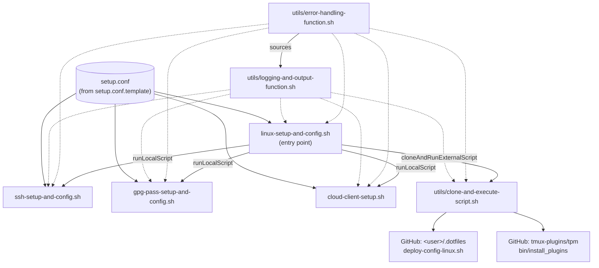
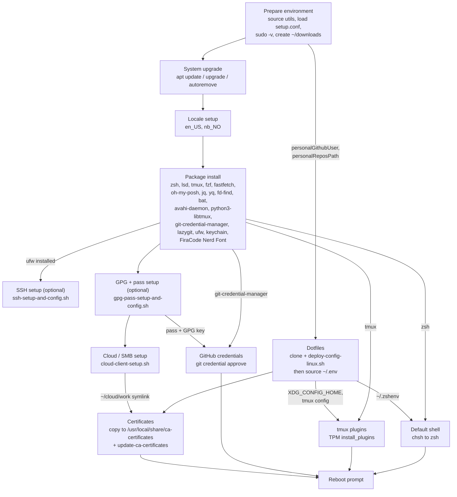
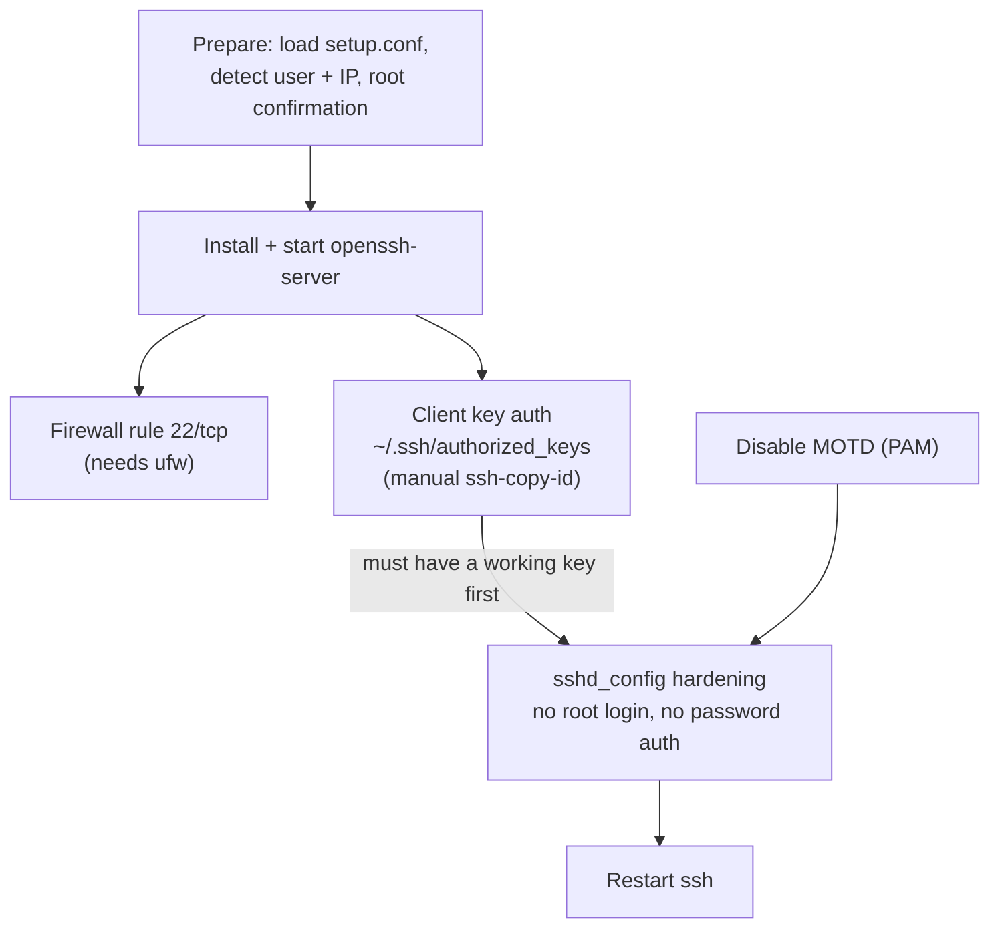
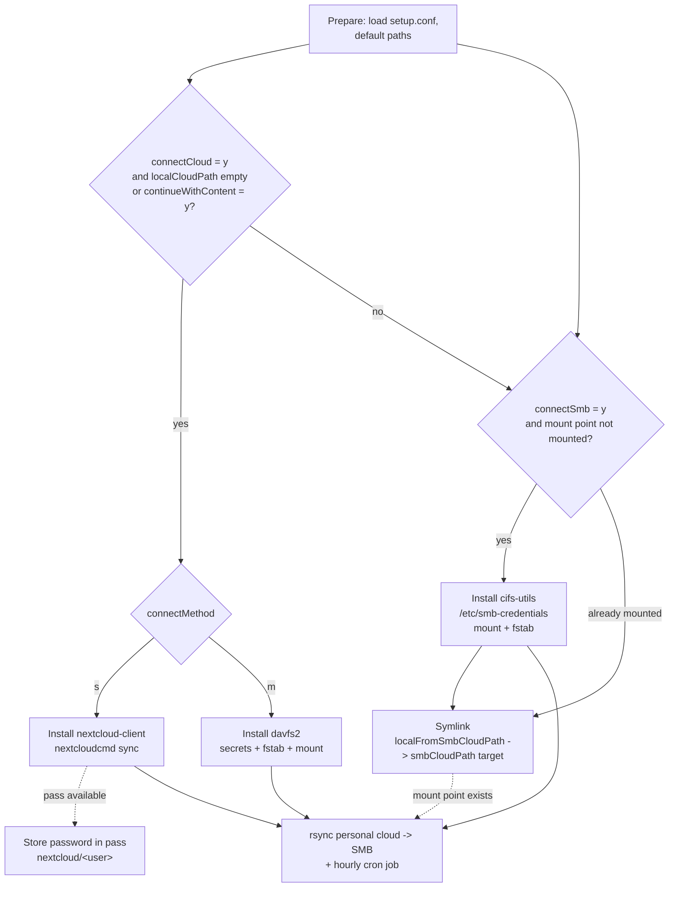

# Setup Dependencies

This document shows which parts of the setup depend on others. Arrows point from a **prerequisite** to the step that **needs** it. Diagrams use [Mermaid](https://mermaid.js.org/) (rendered by GitHub and VS Code).

Legend: solid arrow = hard dependency (step fails or is skipped without it), dashed arrow = soft/optional dependency (step degrades gracefully).

## 1. Script and file level

[linux-setup-and-config.sh](./linux-setup-and-config.sh) is the entry point. It sources the helper utilities and runs the other scripts.

Notes:

- The logger and error handler are optional. Each script falls back to a minimal `logMessage` if the logger is missing (soft dependency). `clone-and-execute-script.sh` has no fallback `logMessage`.
- `setup.conf` is optional. Any value missing from it is prompted for interactively.
- `ssh-setup-and-config.sh`, `gpg-pass-setup-and-config.sh` and `cloud-client-setup.sh` can also run standalone (`--config`), but then they must install/assume their own prerequisites (see below).
- SSH, GPG/pass, personal and work setup are each optional via `setupSsh`, `setupGpgPass`, `setupPersonal` and `setupWork` in `setup.conf` (prompted, default yes, if unset). `setupPersonal` / `setupWork` gate the personal cloud / SMB mount and the matching dotfile paths; `connectCloud` / `connectSmb` remain as sub-options inside them. SSH and GPG/pass are independent of each other. All y/n settings are resolved by `resolveYesNoSetting` in [config-helpers.sh](./config-helpers.sh).
- Child scripts inherit `-d` / `-v` from the main script; they do **not** inherit `--config`. They load the default `setup.conf` next to the script.

## 2. Execution order in `linux-setup-and-config.sh`

Only the edges above are real data/tool dependencies. Steps without an edge between them (for example Certificates and GitHub credentials) are independent and merely run in file order.

## 3. Dependency matrix (main script)

| Step | Needs | Provided by | Hard / soft |
|------|-------|-------------|-------------|
| Everything using `sudo` | Valid sudo session | `sudo -v` at start | Hard (script exits if it fails) |
| Package install | Up-to-date package lists | System upgrade | Soft |
| Package install (`git-credential-manager`, `lazygit`) | `${DOWNLOADS}`, `curl`, `wget` | Prepare environment (`~/downloads`) | Hard |
| Package install (`firacode-nerd-font`) | `${DOWNLOADS}`, `wget`, `tar` with xz support | Prepare environment (`~/downloads`), base system | Soft (failure is logged and skipped; already-extracted font is skipped; `fc-cache` is only run if fontconfig exists) |
| Package install (`fastfetch`) | `add-apt-repository` (PPA) | Pre-installed `software-properties-common` (not installed by the script) | Hard |
| Package install (`fd-find`, `bat`) | `~/.local/bin` | `mkdir -p ~/.local/bin` right before the install loop | Hard |
| SSH setup | `ufw` | Package install | Soft (firewall rule skipped with a warning if missing) |
| GPG/pass setup | `gpg`, `pass` | Base system, apt | None on SSH setup |
| Cloud setup | `pass` + initialized GPG store | GPG/pass setup | Soft (password not saved if `pass` is missing or not initialized) |
| Dotfiles | `personalGithubUser`, `personalReposPath`, `git`, internet | `setup.conf` or prompt | Hard |
| Dotfiles | Selected personal and/or work dotfiles paths (`dotfilesCloudPath`, `dotfilesWorkPath`) with content | `setupPersonal` / `setupWork`, cloud / SMB setup (or existing content) | Soft (scope `both`/`personal`/`work`/`none` is exported as `DOTFILES_SCOPE`; a selected side without content is warned about and asks to continue; unselected sides are ignored silently) |
| Dotfiles | `clone-and-execute-script.sh` | `utils/` | Hard |
| `source ~/.env` | Dotfiles deployed | Dotfiles | Soft (skipped if missing) |
| Certificates | `~/cloud/work/setup/certificates` | Cloud setup (SMB mount + symlink) | Soft (skipped if directory missing) |
| GitHub credentials | `git-credential-manager`, `pass` + GPG key, `personalGithubToken` (`gho_*`) | Package install, GPG/pass setup, `setup.conf` or prompt | Hard for storing; skipped if the password store is not initialized, `~/.password-store` already has a `git` entry or `storeGithubCredentials=n` |
| tmux plugins | `${XDG_CONFIG_HOME}/tmux`, `tmux`, `git` | Dotfiles (`.env` / config), package install | Soft (skipped with warning if the directory is missing) |
| Default shell | `zsh`, `~/.zshenv` | Package install, Dotfiles | Soft (skipped with warning) |
| Shell startup (dotfiles `.zshenv`) | `keychain` | Package install | Hard (errors on every shell start if missing and SSH keys or a `pass` store exist) |
| Reboot prompt | Nothing | n/a | n/a |

## 4. `ssh-setup-and-config.sh` internals

Key points:

- **`sshd_config` hardening must come after a verified client key.** Password login is disabled, so a missing/invalid key locks the user out of SSH. The script waits for a new `ssh-*` line in `authorized_keys` before continuing.
- **Firewall rule needs `ufw`**, which is installed by the main script, not by this one. The rule is added whenever SSH setup runs.
- **`keychain` is not part of this script.** It manages the outgoing SSH agent (and `gpg-agent`) and is installed by the main script. The dotfiles' `keychain-setup.zsh` (sourced from `.zshenv`) calls it unguarded.
- **GPG/pass is not part of this script.** It lives in `gpg-pass-setup-and-config.sh` and does not depend on SSH. `pass init` needs a GPG key: an existing key is reused, otherwise one is generated from `gpgKeyType`, `gpgKeyLength`, `gpgNameReal`, `gpgNameEmail`, `gpgExpireDate`.
- **Downstream consumers of `pass`/GPG:** Nextcloud password storage in `cloud-client-setup.sh` and GitHub credential storage via Git Credential Manager in the main script.

## 5. `cloud-client-setup.sh` internals

Key points:

- **SMB mount is independent of the personal cloud.** The two features only meet in the final rsync step.
- **Symlink step needs the SMB mount** and that the remote share already contains the `smbCloudPath` symlink (default `Cloud/work`). Skipped if no mount point exists (`noSmbShareMountPoint`).
- **Copy/cron step needs all of:** a populated `localCloudPath` (from sync or mount), a mounted SMB share, an existing `smbFromLocalCloudPath` directory on the share, and `rsync`.
- **Method `s` vs `m` are mutually exclusive.** The `m` branch also reuses the `cloudAddress`, `cloudUsername`, `cloudPassword` variables.

## 6. Package-level dependencies in `installPackage`

| Package | Extra requirement | Follow-up |
|---------|-------------------|-----------|
| `fastfetch` | PPA `ppa:zhangsongcui3371/fastfetch` + `apt-get update` | n/a |
| `oh-my-posh` | Binary download (`wget`) to `/usr/local/bin` | `chmod +x` |
| `git-credential-manager` | GitHub releases API (`curl`) and `.deb` download, `dpkg -i` | Delete `.deb` |
| `lazygit` | GitHub releases API (`curl`) and tarball download | Installed to `/usr/local/bin` |
| `firacode-nerd-font` | `FiraCode.tar.xz` download (`wget`) from the Nerd Fonts releases | Extracted to `~/.local/share/fonts/FiraCodeNerdFont`, `fc-cache -f` if available, archive deleted |
| `fd-find` | `~/.local/bin` | Symlink `fdfind` to `fd` |
| `bat` | `~/.local/bin` | Symlink `batcat` to `bat` |
| `avahi-daemon` | `systemd` | `systemctl enable --now` |
| `ufw` | n/a | Used later by SSH setup |
| `tmux` | n/a | Used later by the TPM step |
| `zsh` | n/a | Used later by the default shell step |

## 7. Configuration variables by consumer

| `setup.conf` section | Variables | Consumed by |
|----------------------|-----------|-------------|
| Features | `setupSsh`, `setupGpgPass`, `setupPersonal`, `setupWork`, `rebootAfterSetup` | `linux-setup-and-config.sh` (`setupPersonal`, `setupWork` also `cloud-client-setup.sh`) |
| Personal cloud | `connectCloud`, `continueWithContent`, `connectMethod` | `cloud-client-setup.sh` |
| Cloud | `cloudAddress`, `cloudUsername`, `cloudPassword` | `cloud-client-setup.sh` |
| SMB share | `connectSmb`, `smbHost`, `smbShare`, `smbMountPoint`, `smbUsername`, `smbPassword` | `cloud-client-setup.sh` |
| Paths | `localCloudPath`, `localFromSmbCloudPath`, `smbCloudPath`, `smbFromLocalCloudPath` | `cloud-client-setup.sh` (the main script's certificate step hardcodes `~/cloud/work/setup/certificates`, which assumes `localFromSmbCloudPath` keeps its default; the dotfiles also hardcode `~/cloud/personal`, `~/cloud/work` and `~/workspace/personal/repos/.dotfiles`) |
| Paths | `dotfilesCloudPath`, `dotfilesWorkPath` | `linux-setup-and-config.sh` (pre-dotfiles scope check) |
| GPG | `gpgKeyType`, `gpgKeyLength`, `gpgNameReal`, `gpgNameEmail`, `gpgExpireDate` | `gpg-pass-setup-and-config.sh` |
| GitHub | `storeGithubCredentials`, `personalGithubToken` | `linux-setup-and-config.sh` (credentials step) |
| GitHub | `personalGithubUser`, `personalReposPath` | `linux-setup-and-config.sh` (dotfiles clone, repo paths) |

## 8. Observed gaps and ordering risks

These follow from the dependencies above and are not fixed here.

- **`rsync` and `cron` are assumed to be present** (standard on Ubuntu), not installed by the scripts. On WSL, cron only runs with systemd enabled.
- **`software-properties-common`** (provides `add-apt-repository`) is assumed for both `fastfetch` and Nextcloud CLI.
- **Cloud setup runs before dotfiles**, so anything the dotfiles would put in place (for example `XDG_CONFIG_HOME`) is not available to the cloud script.
- **`pass` is only initialized if GPG/pass setup runs and a key is created or chosen.** Otherwise the Nextcloud password store and GitHub credential store lose their backend (both are skipped).
- **`timestamp` in `ssh-setup-and-config.sh`** is used in the PAM backup file name in the MOTD step before it is assigned later in the SSH configuration step, so that first backup name has no timestamp.
- **README mismatch:** the README names `install-linux.sh` as the dotfiles script, while the code runs `deploy-config-linux.sh`.
- **The dotfiles script's own requirements** (for example what it expects from `git-credential-manager` or `pass`) are outside this repo and not covered here.
